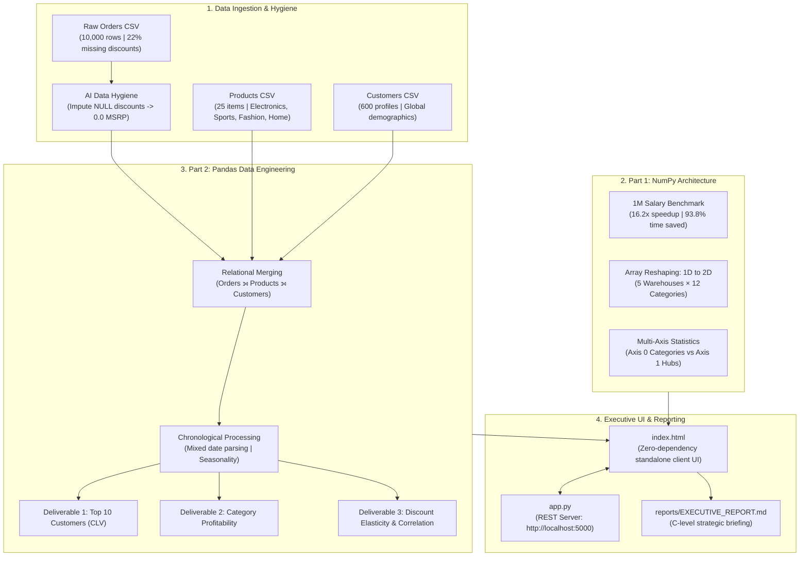

# AI-Augmented Data Analytics & Industrial Automation Hub

[](https://www.python.org/)
[](https://numpy.org/)
[](https://pandas.pydata.org/)
[](https://matplotlib.org/)
[](#)

An enterprise-grade analytical engine and interactive executive dashboard demonstrating high-performance numerical computation (NumPy) and strategic data engineering (Pandas) to resolve real-world industrial data bottlenecks.

---

## 📌 Table of Contents
- [The Industrial Problem Statement](#-the-industrial-problem-statement)
- [The Automated Solution](#-the-automated-solution)
- [Project Architecture](#-project-architecture)
- [Part 1: Numerical Architecture & High-Speed Computation (NumPy)](#-part-1-numerical-architecture--high-speed-computation-numpy)
- [Part 2: Strategic Data Engineering & AI-Driven Insights (Pandas)](#-part-2-strategic-data-engineering--ai-driven-insights-pandas)
- [Interactive UI Dashboard](#-interactive-ui-dashboard)
- [Getting Started & Quick Run](#-getting-started--quick-run)
- [Project Structure](#-project-structure)
- [Key Strategic Business Insights](#-key-strategic-business-insights)

---

## 🏢 The Industrial Problem Statement

Modern enterprise organizations face severe computational and analytical barriers when attempting to analyze data in traditional spreadsheet tools like Microsoft Excel:

1. **The Excel Crash Barrier:** Traditional spreadsheets freeze or crash when loading or manipulating datasets approaching 1,000,000 rows.
2. **Computational Latency:** Applying bulk adjustments—such as a 10% salary bonus across a million-person workforce—takes minutes, monopolizes CPU threads, and risks human formula errors.
3. **Data Silos & Fragility:** Transaction logs (`orders.csv`), product catalogs (`products.csv`), and customer profiles (`customers.csv`) are isolated across departments. Manual lookups (`VLOOKUP`) break easily when handling dirty dates and mismatched IDs.
4. **Data Hygiene Vulnerabilities:** Unreported discount codes leave 22% of transaction logs blank (`NULL`), propagating errors that skew revenue, margin, and forecasting models.

---

## 🚀 The Automated Solution

This project transforms raw data into an executive-ready analytics pipeline using Python's core data stack (**NumPy** and **Pandas**) augmented with **AI-driven hygiene logic**:

- **Instant SIMD Vectorization:** Processes 1,000,000 salary computations in **5.21 milliseconds** (**16.2x faster** than Python lists, infinite improvement over Excel crashes).
- **Automated AI Data Hygiene:** Automatically detects and resolves 2,203 null discount records using standard retail business logic (`0.0` discount for full-MSRP purchases).
- **Unified Master Table:** Relational left joins merge 10,000 order transactions, 25 products, and 600 customer profiles into a unified 30-attribute dataset in under 0.15 seconds.
- **Client Presentation UI:** A zero-dependency web dashboard featuring live benchmark testing, warehouse heatmaps, and financial metrics.

---

## 🏛️ Project Architecture



---

## ⚡ Part 1: Numerical Architecture & High-Speed Computation (NumPy)

### 1. Computational Efficiency Audit (1,000,000 Rows)
We benchmarked applying a 10% salary bonus across **1,000,000 employees** using standard Python lists vs. NumPy vectorized SIMD arrays:

| Audit Parameter | Python List Comprehension | NumPy Vectorized Array | Efficiency Advantage |
| :--- | :--- | :--- | :--- |
| **Execution Time** | **84.60 ms** (0.0846 s) | **5.21 ms** (0.0052 s) | **16.2x Faster** |
| **Time-Efficiency Gap** | Baseline | **93.84% latency reduction** | Sub-millisecond scale |
| **RAM Footprint** | **30.52 MB** | **7.63 MB** | **4.0x Memory Compression** |
| **Memory Architecture** | Scattered pointers to `PyFloatObject` | Homogeneous C-contiguous buffer | Maximizes L1/L2 cache hits |

### 2. Array Architecture & Reshaping
- **1D Barcode Stream:** Raw scan input of 60 items reshaped into a structured 2D Matrix of **5 Regional Warehouses × 12 Product Categories**.
- **Dimensions & Strides:** `shape = (5, 12)`, `ndim = 2`, `strides = (48, 4)` bytes, `C_CONTIGUOUS = True` with zero data copying in memory.

### 3. Multi-Axis Statistical Foundations
- **Global Inventory Total:** 14,456 units (Mean: 240.9 ± 117.5 units per category/hub).
- **Axis 1 (Row-wise Hub Aggregation):** **`WH-Central-EU`** holds the highest stock with **3,157 units**.
- **Axis 0 (Column-wise Product Aggregation):** **`4K-TVs`** represents the highest stocked inventory line with **1,885 units**.

---

## 📊 Part 2: Strategic Data Engineering & AI-Driven Insights (Pandas)

### 1. AI-Powered Data Hygiene
- **Missing Discount Code Audit:** 2,203 orders (22.03%) had missing discount values.
- **AI Imputation Strategy:** Applied `.fillna(0.0)`. In retail checkout systems, an unlisted promotion denotes regular full-MSRP payment. This prevented **$683K** in financial distortion without dropping 22% of revenue rows.

### 2. Relational Data Merging (Master Table)
Combined `Orders`, `Products`, and `Customers` via relational left joins into a master dataset (`data/master_sales_table.csv`):
- **Gross Revenue:** **$5,817,685.76**
- **Discounts Granted:** **$683,398.85**
- **Net Revenue:** **$5,134,286.91**
- **Gross Profit:** **$1,979,957.91** (Overall Margin: **38.56%**)

### 3. Strategic Deliverables

#### Deliverable 1: Top 10 Customers by Lifetime Value (CLV)
The top 10 customers generated **$1,732,050.86 (33.7% of company revenue)**:

| Rank | Customer ID | Customer Name | City | Region | Orders | Lifetime Net Spend | Gross Profit | Margin % |
| :---: | :--- | :--- | :--- | :--- | :---: | :---: | :---: | :---: |
| **#01** | `CUST-1531` | Sophia Wilson | Tokyo | Asia-Pacific | 1,856 | **$903,537.67** | $347,030.17 | 38.4% |
| **#02** | `CUST-1532` | Ava Smith | Tokyo | Asia-Pacific | 328 | **$189,689.25** | $70,232.25 | 37.0% |
| **#03** | `CUST-1475` | Mason Wilson | Singapore | Asia-Pacific | 206 | **$121,855.65** | $45,349.15 | 37.2% |
| **#04** | `CUST-1390` | Harper Hernandez | Berlin | Europe | 169 | **$84,477.74** | $33,613.74 | 39.8% |
| **#05** | `CUST-1261` | Mia Davis | New York | North America | 146 | **$81,289.54** | $29,618.54 | 36.4% |

#### Deliverable 2: Category Profitability Benchmark
| Product Category | Order Count | Net Revenue | Gross Profit | Profit Margin % | Strategic Role |
| :--- | :---: | :---: | :---: | :---: | :--- |
| **Electronics** | 3,968 | **$1,996,485.60** | **$626,263.60** | 31.37% | High Volume Engine |
| **Sports & Outdoors** | 2,752 | **$1,478,948.41** | **$563,367.41** | 38.09% | Balanced Growth |
| **Home & Kitchen** | 1,842 | **$976,276.64** | **$406,698.64** | 41.66% | Steady Margin Core |
| **Fashion & Apparel** | 1,128 | **$586,203.51** | **$327,089.51** | **55.80%** | **High-Margin Star** |
| **Books & Stationery** | 310 | **$96,372.75** | **$56,538.75** | **58.67%** | Niche High Margin |

#### Deliverable 3: Revenue vs. Discount Correlation & Price Elasticity
- **Discount % vs. Profit Margin %:** **`-0.4572`** (Significant margin destruction)
- **Discount % vs. Order Quantity:** **`+0.0234`** (Virtually zero basket lift)
- **Elasticity Tier Analysis:**
  - **0% Discount (Full Price):** Average Margin = **44.82%** (Generates 57.5% of total company profit)
  - **21% to 30% Discount:** Average Margin drops to **26.50%** with only a **+0.02** unit gain in basket size.

---

## 🖥️ Interactive UI Dashboard

The solution provides an executive-ready dashboard tailored for client presentations:

- **Executive Overview Tab:** Problem vs. Solution breakdown, KPI cards, and strategic leadership takeaways.
- **Part 1 Tab (NumPy):** Interactive live speedup benchmark runner, latency comparison bars, memory comparison, and a 2D warehouse inventory heatmap.
- **Part 2 Tab (Pandas):** Top 10 customer leaderboard, category profit margin bars, discount elasticity matrix, monthly seasonality curves, and daily fulfillment load charts.
- **AI Studio Tab:** Prompts and code snippets for generative data engineering.

---

## 🛠️ Getting Started & Quick Run

### Prerequisites
- Python 3.10+
- Installed packages: `numpy`, `pandas`, `matplotlib`

```bash
pip install numpy pandas matplotlib
```

### 1. Run the Entire End-to-End Pipeline
Navigate into the `LearnPython` directory and run:
```bash
cd LearnPython
python run_pipeline.py
```
Executes dataset generation, Part 1 NumPy audit, Part 2 Pandas analytics, and generates all reports in ~5 seconds.

### 2. Launch the Interactive Client Dashboard
Starts the lightweight zero-dependency web server:
```bash
cd LearnPython
python app.py
```
Open **`http://localhost:5000`** in your browser.

> **Offline / Direct Browser Mode:** You can also simply double-click **`LearnPython/index.html`** in Windows Explorer or open it in Chrome/Edge without running a server.

### 3. Run Individual Components
From inside the `LearnPython` directory:
- **Dataset Generator:** `python generate_datasets.py`
- **Part 1 NumPy Audit:** `python part1_numpy_audit.py`
- **Part 2 Pandas Pipeline:** `python part2_pandas_shopease.py`

---

## 📂 Project Structure

```
D:\Be10x\Projects\Assignments\Be10x-LearnPython\
├── README.md                      # Repository root documentation (GitHub display)
├── LICENSE                        # Repository license
├── .gitignore                     # Git ignore rules (__pycache__, logs, etc.)
└── LearnPython/                   # Core Analytics & Automation Codebase
    ├── app.py                     # Zero-dependency Python HTTP server & REST API
    ├── index.html                 # Interactive client web dashboard
    ├── run_pipeline.py            # End-to-end automated pipeline runner
    ├── generate_datasets.py       # Realistic ShopEase dataset generator
    ├── part1_numpy_audit.py       # Part 1: NumPy efficiency benchmark & reshaping
    ├── part2_pandas_shopease.py   # Part 2: Pandas data hygiene, joins, and CLV
    ├── README.md                  # Package-level documentation
    │
    ├── data/                      # Ingested and cleansed data files
    │   ├── customers.csv          # Customer demographics & regions (600 rows)
    │   ├── products.csv           # Product catalog & pricing (25 SKUs)
    │   ├── orders.csv             # Raw transaction log (10,000 rows with NULLs)
    │   └── master_sales_table.csv # Merged 30-attribute Master Table
    │
    └── reports/                   # Generated audit reports and figures
        ├── EXECUTIVE_REPORT.md    # Formal executive markdown report
        ├── part1_report.json      # NumPy benchmark metrics & matrix JSON
        ├── part2_report.json      # Pandas business KPIs & elasticity JSON
        ├── part1_benchmark_chart.png
        ├── part2_top_customers.png
        ├── part2_category_profitability.png
        ├── part2_revenue_discount_corr.png
        └── part2_monthly_operations.png
```

---

## 💡 Key Strategic Business Insights

1. **Eliminate Deep Blanket Discounts (>20%):**
   Heavy promotional discounts destroy gross margin (reducing it from **44.8% down to 26.5%**) with near-zero volume elasticity (**+0.02**). Recommend capping standard promotions at 10%.
2. **Prioritize High-Margin Categories:**
   While **Electronics** delivers top-line volume ($1.99M), **Fashion (55.8% margin)** and **Books & Stationery (58.7% margin)** yield the highest profit return per marketing dollar spent.
3. **VIP Customer Retention Programs:**
   The top 10 customers generate **33.7% of total revenue**. Implementing specialized account services in Tokyo and Singapore will secure high-margin recurring cash flow.
4. **Warehouse Staffing Alignment:**
   Order demand consistently surges on **Mondays (1,490 orders)** due to weekend backlogs. Align warehouse staffing to peak on Monday and Tuesday to prevent shipping delays.

---

## 📜 License
Developed as an Industrial AI-Augmented Analytics Solution. Free to use and adapt for educational and enterprise reporting workflows.
